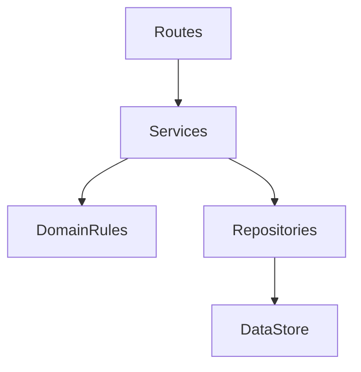
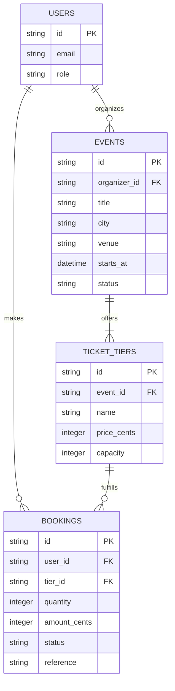
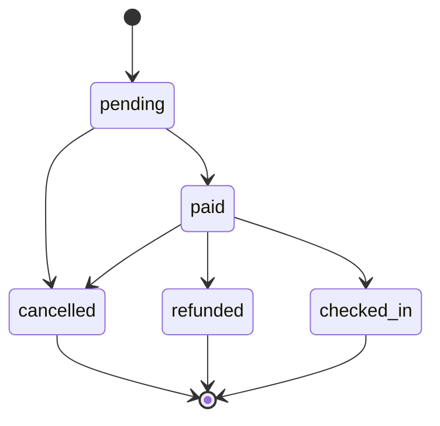

# Architecture

## Layers

- **Routes** may interpret HTTP requests and call services; they may not contain business rules or access storage directly.
- **Services** may coordinate domain rules and repositories; they may not handle HTTP details or depend on route handlers.
- **Domain rules** may enforce business invariants; they may not perform HTTP or persistence I/O.
- **Repositories** may read and write data; they may not make business decisions or call services/routes.
- **Data store** holds persisted data; it does not call application layers.

## Data model

## Booking life cycle

